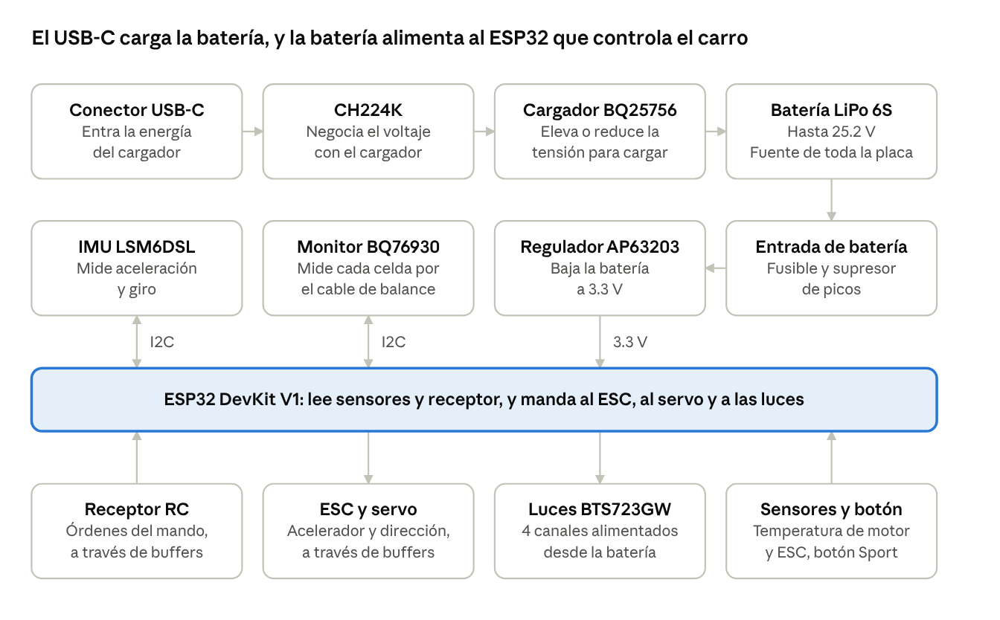

# Carrito Don Julio: explicación de la placa principal (rev D)

Revisión D, ruteo 3. Documento del 12 de noviembre de 2026, verificado contra `proyecto_revD/cdj_revD.kicad_pcb`.

## Resumen

La placa principal es el cerebro y la fuente de alimentación del carro: recibe la batería, la carga por USB-C, genera 3.3 V para la electrónica, lee el receptor de radio y manda las órdenes al ESC, al servo y a las luces.

| Dato | Valor |
| --- | --- |
| Vehículo | RC 1:7, 4WD, objetivo 60 km/h |
| Batería | LiPo 6S: 22.2 V nominal, 25.2 V cargada |
| Tamaño de la placa | 130 × 100 mm |
| Capas de cobre | 4 |
| Componentes | 204 |
| Microcontrolador | ESP32 DevKit V1 (30 pines) en zócalo |
| Herramienta | KiCad 9.0 |

Nada de esta placa se ha fabricado ni probado todavía. Lo que se describe aquí es el diseño tal como está en el proyecto `cdj_revD`.

## Mapa de bloques

La fila de arriba es el camino de carga. El CH224K no conduce la energía: solo negocia el voltaje, y la corriente va del conector USB-C al cargador. La batería alimenta al regulador de 3.3 V, que da energía al ESP32 y a los sensores. El cargador BQ25756 también se configura por el bus I2C.

## Entrada USB-C y negociación de 20 V

El puerto USB-C sirve solo para cargar la batería. Un cargador USB entrega 5 V por defecto; para cargar una 6S con buena potencia hay que pedirle 20 V, y eso lo hace el CH224K.

| Ref. | Componente | Función | Por qué está |
| --- | --- | --- | --- |
| J3 | Conector USB-C de 16 pines | Entrada de carga | Solo usa VBUS, GND y las líneas CC. Las líneas de datos quedan sin conectar |
| U2 | CH224K | Negocia 20 V con el cargador (USB Power Delivery) | Sin él, el cargador solo daría 5 V. Es un chip que hace la negociación sin firmware |
| R15, C16 | 1 kΩ, 1 µF | Alimentación del CH224K desde VBUS | El chip trabaja a baja tensión; la resistencia limita la corriente cuando VBUS sube a 20 V |
| R16 | 10 kΩ | Le deja al CH224K medir la tensión de VBUS | Confirma que el cargador entregó lo que se pidió |
| D5 | SMF24CA (TVS) | Recorta picos de tensión en VBUS | Protege al conectar y desconectar el cable. 24 V queda justo sobre los 20 V de trabajo |
| C17, C18 | 10 µF 35 V | Reserva de energía en la entrada | Estabilizan VBUS frente a los pulsos de corriente del cargador |
| TP1 | Punto de prueba | Medir VBUS con multímetro | Diagnóstico |

El ESP32 no se programa por este puerto, sino por el micro-USB del propio DevKit.

## Cargador de batería BQ25756

El BQ25756 convierte la tensión del USB (5 a 20 V) en la tensión que necesita la batería (hasta 25.14 V) y controla la corriente de carga. Es un convertidor buck-boost: puede subir o bajar la tensión, porque 20 V de entrada queda por debajo de los 25.2 V de la batería llena.

El chip es solo el controlador. La potencia pasa por cuatro MOSFET y un inductor que están fuera del chip.

**Etapa de potencia**

| Ref. | Componente | Función | Por qué está |
| --- | --- | --- | --- |
| U5 | BQ25756 | Controlador del cargador | Admite de 1 a 14 celdas y entrada USB PD; se configura con resistencias y por I2C |
| Q1, Q2 | BSC028N06LS3 (60 V, 2.8 mΩ) | Medio puente del lado de entrada | Conmutan la entrada sobre el inductor |
| Q3, Q4 | BSC028N06LS3 | Medio puente del lado de batería | Conmutan el inductor hacia la batería |
| L2 | 10 µH, 6.5 A (Vishay IHLP4040) | Inductor del convertidor | Almacena energía en cada ciclo; es lo que permite subir o bajar la tensión |
| C22 a C25 | 4 × 10 µF 50 V | Condensadores de entrada del puente | Entregan los pulsos de corriente que piden Q1 y Q2 |
| C31 a C34 | 4 × 10 µF 50 V | Condensadores de salida del puente | Alisan la corriente que va a la batería |
| C27, C28 | 100 nF | Condensadores de bootstrap | Dan la tensión extra para encender los MOSFET de arriba (Q1 y Q4) |
| D6, D7 | 1N5819HW (Schottky) | Diodos de bootstrap | Recargan C27 y C28 en cada ciclo |
| C29, C30, R23 | 4.7 µF, 4.7 µF, 10 Ω | Alimentación interna de los drivers (REGN y DRV) | Los drivers de compuerta necesitan su propia reserva de energía, pegada al chip |

**Medición de corriente**

| Ref. | Componente | Función |
| --- | --- | --- |
| R17 | 5 mΩ | Mide la corriente que entra por el USB |
| R18, R19, C19, C20, C21 | 10 Ω, 10 Ω, 470 nF, 100 nF, 100 nF | Filtro de esa medición |
| R24 | 5 mΩ | Mide la corriente que va a la batería |
| R25, R26, C35, C36, C37 | 10 Ω, 10 Ω, 470 nF, 100 nF, 100 nF | Filtro de esa medición |

**Resistencias que fijan el comportamiento**

| Ref. | Valor | Qué fija | Resultado |
| --- | --- | --- | --- |
| R27, R28 | 249 kΩ, 16.2 kΩ | Tensión final de carga | 25.14 V (4.19 V por celda) |
| R29 | 24.9 kΩ | Corriente de carga | 2.0 A |
| R30 | 6.65 kΩ | Límite de corriente de entrada | 3.0 A (60 W a 20 V) |
| R31 | 133 kΩ | Frecuencia de conmutación | 250 kHz |
| R20, R21, R22 | 1 MΩ, 261 kΩ, 73.2 kΩ | Ventana de tensión de entrada aceptada | 4.4 a 21.9 V |
| R32, R33 | 5.23 kΩ, 30.1 kΩ | Rango de temperatura de batería permitido | Usa el NTC conectado en J4 |

**Control e indicadores**

| Ref. | Componente | Función |
| --- | --- | --- |
| J4 | Conector del NTC de batería (10 kΩ) | Sensor pegado a la LiPo. Sin él conectado, el cargador no carga |
| R37 | 10 kΩ a GND en CE | Deja la carga habilitada aunque el ESP32 no esté puesto |
| R38 | 10 kΩ a 3.3 V en INT | Línea de aviso del cargador hacia el ESP32 |
| D8, D9, D10 con R34, R35, R36 | LED naranja, verde, azul | Estado de carga (STAT1, STAT2) y entrada válida (PG) |
| C26 | 1 µF 50 V | Desacoplo de la alimentación del chip |
| TP2, TP3 | Puntos de prueba | Salida del cargador y línea INT |

## Monitor y balanceo de celdas BQ76930

El BQ76930 mide la tensión de cada una de las 6 celdas por el cable de balanceo y puede descargar un poco las más altas para igualarlas. Una LiPo cargada en serie sin vigilar cada celda puede sobrecargar una de ellas, y eso es un riesgo de incendio.

| Ref. | Componente | Función | Por qué está |
| --- | --- | --- | --- |
| U1 | BQ7693002 | Mide las 6 celdas, balancea y avisa por I2C | Variante con salida de 3.3 V, dirección I2C 0x08 y sin CRC, que simplifica el firmware |
| J2 | Conector JST-XH de 7 pines | Entrada del cable de balanceo de la LiPo 6S | Es el conector estándar de balanceo: 6 celdas dan 7 hilos |
| R1 a R8 | 100 Ω | Resistencia en serie de cada toma de celda | Filtran ruido y limitan la corriente de balanceo |
| C3 a C10 | 1 µF | Condensador entre tomas vecinas | Con las resistencias forman el filtro que pide el fabricante |
| R9, C11, D2 | 100 Ω, 10 µF 50 V, 1N4148W | Alimentación del chip desde la batería | Filtro y diodo que mantienen el chip alimentado durante caídas breves |
| R10, C12, D3 | 100 Ω, 10 µF 25 V, 1N4148W | Alimentación del bloque inferior del chip | El chip está dividido en dos mitades; esta alimenta la de abajo desde la toma media |
| C13, C14, C15 | 1 µF, 4.7 µF, 1 µF | Condensadores de los reguladores internos | Los exige el fabricante para que el chip sea estable |
| TH1 | NTC 10 kΩ | Sensor de temperatura en la placa | El chip necesita un termistor para funcionar |
| R11 | 10 kΩ | Sustituye al segundo termistor | La mitad superior del chip también espera uno; como no se usa, se pone una resistencia fija |
| D4, R12, R13 | 1N5819HW, 1 kΩ, 1 kΩ | Pulso de arranque desde el ESP32 | El chip arranca dormido y hay que despertarlo con un pulso; el diodo aísla el pin del ESP32 |
| R14 | 1 MΩ | Fija la línea ALERT en reposo | Por ALERT el chip avisa al ESP32 de una falla |

Esta placa mide y balancea, pero no tiene interruptores que corten la batería por sí sola. La reacción ante una falla depende del firmware, que todavía no está escrito.

## Entrada de batería y protecciones

La batería entra por un conector XT30 y pasa por un fusible antes de llegar al resto de la placa. El motor no pasa por esta placa: el ESC se conecta directo a la batería, en paralelo.

| Ref. | Componente | Función | Por qué está |
| --- | --- | --- | --- |
| J1 | XT30 | Entrada de batería 6S | Conector polarizado, común en modelismo |
| F1 | Fusible 5 A | Corta si la placa o el cargador consumen de más | Una LiPo puede entregar cientos de amperios en un corto |
| D1 | SMF26CA (TVS) | Recorta picos de tensión en la línea de batería | El motor y los cables largos generan picos. 26 V queda justo sobre los 25.2 V de la batería llena |
| C41 | 220 µF 50 V (electrolítico) | Reserva de energía en la entrada | Amortigua las caídas de tensión cuando el motor acelera |
| TP6 | Punto de prueba | Medir la tensión de batería | Diagnóstico |
| H1 a H4 | Agujeros M3 | Fijación al chasis | Están unidos a GND |

## Regulador de 3.3 V (AP63203)

El AP63203 baja los 18 a 25.2 V de la batería a 3.3 V para toda la electrónica de control. Es un regulador conmutado: a esa diferencia de tensión, uno lineal desperdiciaría casi toda la energía en calor.

| Ref. | Componente | Función | Por qué está |
| --- | --- | --- | --- |
| D11 | MBRA340T (Schottky 3 A) | Bloquea la corriente si la batería se conecta al revés | Protege al regulador y a todo lo que cuelga de él |
| C46 | 100 µF 50 V (electrolítico) | Reserva de energía antes del regulador | Mantiene estable su entrada |
| C42 | 10 µF 50 V | Condensador de entrada del regulador | Lo pide el fabricante, pegado al chip |
| U3 | AP63203WU | Regulador reductor a 3.3 V, hasta 2 A | Componente de la lista del profesor |
| C43 | 100 nF | Condensador de bootstrap | Permite encender el interruptor interno del chip |
| L1 | 4.7 µH (APH0630T4R7M) | Inductor del regulador | Almacena energía en cada ciclo; componente de la lista del profesor |
| C44, C45 | 2 × 22 µF 16 V | Condensadores de salida | Alisan los 3.3 V |
| JP1 | Puente de soldadura (cerrado) | Une la salida del regulador con el riel de 3.3 V | Se abre para medir consumo o para aislar el regulador en pruebas |
| D12 | SMF3.3 (TVS) | Recorta picos en el riel de 3.3 V | Protege al ESP32 y a los sensores |
| C1 | 47 µF 10 V | Reserva junto al ESP32 | El WiFi consume en picos cortos |
| R73 | 0 Ω | Une la entrada de habilitación del regulador con el interruptor | Si no se monta, el regulador queda siempre encendido |
| J5 | Conector de interruptor | Interruptor de la electrónica en el chasis | Abierto es encendido; cerrado a GND apaga el regulador |
| TP8, TP12 | Puntos de prueba | Medir 3.3 V y GND | Diagnóstico |
| D13, R39 | LED verde, 2.2 kΩ | Indica que hay 3.3 V | Señal visual de placa encendida |

## Microcontrolador: ESP32 DevKit V1

El ESP32 (U4) es el que decide: lee el receptor, los sensores y el estado de la batería, y genera las señales para el ESC, el servo y las luces. Va montado en un zócalo de dos tiras hembra de 15 pines, así se puede quitar, reemplazar o programar fuera de la placa.

Se alimenta por su pin de 3.3 V desde el AP63203; el pin VIN queda sin conectar. C38 (22 µF) y C39 (100 nF) están junto al zócalo para filtrar esa alimentación.

| Pin del DevKit | Señal en la placa | Para qué |
| --- | --- | --- |
| VP / GPIO36 | NTC\_MOTOR | Temperatura del motor |
| VN / GPIO39 | NTC\_ESC | Temperatura del ESC |
| GPIO34 | RC\_CH1 | Canal 1 del receptor |
| GPIO35 | RC\_CH2 | Canal 2 del receptor |
| GPIO32 | RC\_CH3 | Canal 3 del receptor |
| GPIO33 | SPORT\_BTN | Botón de autorización del modo Sport |
| GPIO25 | ESC\_PWM | Señal de acelerador hacia el ESC |
| GPIO26 | SERVO\_PWM | Señal de dirección hacia el servo |
| GPIO27 | IMU\_INT1 | Aviso de la IMU |
| GPIO14 | AFE\_ALERT | Aviso del monitor de celdas |
| GPIO12 | LT\_REAR | Luces traseras |
| GPIO13 | CHG\_CE | Habilitar o detener la carga |
| GPIO23 | AFE\_BOOT | Pulso para despertar al monitor de celdas |
| GPIO22 | I2C\_SCL | Reloj del bus I2C |
| GPIO21 | I2C\_SDA | Datos del bus I2C |
| GPIO19 | LT\_ST\_B | Diagnóstico del segundo interruptor de luces |
| GPIO18 | LT\_ST\_A | Diagnóstico del primer interruptor de luces |
| GPIO5 | LT\_AUX | Luz de freno o auxiliar |
| TX2 / GPIO17 | RC\_TX | Transmisión serie hacia el receptor |
| RX2 / GPIO16 | RC\_RX | Recepción serie desde el receptor |
| GPIO4 | OUT\_EN\_N | Habilita las salidas al ESC y al servo |
| GPIO2 | LT\_FRONT | Luces delanteras |
| GPIO15 | LT\_SPORT | Luces del modo Sport |

Quedan libres EN, VIN, TX0 y RX0. TX0 y RX0 son los que usa el micro-USB del DevKit para programar.

La huella tiene la fila derecha duplicada (a 22.86 y a 25.4 mm de la izquierda) porque los clones del DevKit vienen en los dos anchos.

## Sensor de movimiento (IMU) y bus I2C

La IMU LSM6DSL (U6) mide aceleración y giro en 3 ejes cada una. Con esos datos el firmware puede detectar derrapes, vuelcos o inclinación y ajustar el acelerador.

| Ref. | Componente | Función | Por qué está |
| --- | --- | --- | --- |
| U6 | LSM6DSL | Acelerómetro y giroscopio de 6 ejes | Habla por I2C en la dirección 0x6A |
| C40, C47, C48 | 100 nF, 100 nF, 1 µF | Desacoplo de la IMU | Un sensor analógico necesita alimentación limpia para no medir ruido |
| R68, R69 | 4.7 kΩ | Pull-up de SDA y SCL | El bus I2C solo tira las líneas a GND; estas resistencias las devuelven a 3.3 V |
| J20 | Conector de 4 pines | Expansión I2C | Para añadir otro sensor o una pantalla sin modificar la placa |

Tres chips comparten el mismo bus I2C, cada uno con su dirección: la IMU (0x6A), el cargador BQ25756 (0x6B) y el monitor de celdas BQ76930 (0x08).

## Entradas del receptor de radio control

El receptor trabaja a 5 V o más y el ESP32 solo tolera 3.3 V en sus pines, así que cada señal del receptor pasa por un buffer que la baja a 3.3 V. Hay dos formas de conectar el receptor: tres canales PWM sueltos o un enlace serie.

| Ref. | Componente | Función | Por qué está |
| --- | --- | --- | --- |
| J7, J8, J9 | Conectores de 3 pines | Canales PWM 1, 2 y 3 del receptor | Mismo formato que un cable de servo: señal, alimentación, GND |
| J6 | Conector de 4 pines | Receptor serie (CRSF, SBUS o iBUS) | Un solo cable lleva todos los canales |
| U7, U8, U9, U10 | 74LVC1G125 | Buffer de entrada tolerante a 5 V | Convierte la señal del receptor a 3.3 V. U7 es la entrada serie; U8 a U10, los canales PWM |
| R41, R43, R45, R47 | 1 kΩ en serie | Limitan la corriente de entrada | Protegen el buffer si llega una tensión indebida |
| R42, R44, R46, R48 | 100 kΩ a GND | Fijan la entrada cuando no hay nada conectado | Sin ellas, una entrada al aire leería ruido |
| D19, D20, D21, D22 | ESD5Z3.3T | Protección contra descargas electrostáticas | Son conectores que se tocan con la mano |
| R40, D18 | 220 Ω, ESD5Z3.3T | Protección de la línea de transmisión hacia el receptor | Solo se usa con receptores que aceptan telemetría |
| C49 a C52 | 100 nF | Desacoplo de cada buffer | Uno por chip |

El receptor se alimenta desde la línea VSERVO, no desde los 3.3 V de la placa.

## Salidas hacia el ESC y el servo

El ESP32 no manda las señales directo al ESC y al servo: pasan por buffers que el firmware tiene que habilitar. Al encender, las salidas están apagadas, así el carro no acelera solo mientras el ESP32 arranca.

| Ref. | Componente | Función | Por qué está |
| --- | --- | --- | --- |
| U11 | 74LVC1G125 | Buffer de la señal del ESC | Tiene una entrada de habilitación |
| U12 | 74LVC1G125 | Buffer de la señal del servo | Ídem |
| R49 | 10 kΩ a 3.3 V | Mantiene los buffers deshabilitados en el arranque | Hasta que el firmware baja la línea OUT\_EN\_N, no sale ninguna señal |
| R50, R54 | 100 Ω en serie | Protegen la salida | Limitan la corriente si el cable se pone en corto |
| R53, R55 | 10 kΩ a GND | Dejan la señal en cero cuando el buffer está deshabilitado | El ESC interpreta la ausencia de pulsos como señal perdida |
| D25, D14 | ESD5Z3.3T | Protección electrostática | En los conectores del ESC y del servo |
| C53, C54 | 100 nF | Desacoplo de los buffers | Uno por chip |
| J10 | Conector de 3 pines | Salida al ESC | Señal, BEC del ESC y GND |
| J11 | Conector de 3 pines | Salida al servo | Señal, VSERVO y GND |
| J12 | XT30 | Entrada de alimentación del servo (BEC externo) | El servo consume demasiado para alimentarlo desde la placa |
| JP2 | Puente de soldadura (abierto) | Une el BEC del ESC con VSERVO | Se cierra solo si el servo se va a alimentar con el BEC del ESC |
| C2 | 470 µF 16 V (electrolítico) | Reserva de energía del servo | El servo pide picos de corriente al moverse; sin reserva, la tensión cae y el receptor se reinicia |

## Luces

Las luces se encienden directo desde la batería a través de dos interruptores BTS723GW, cada uno con 2 canales. Un pin del ESP32 no puede manejar 25 V ni la corriente de los LED; estos interruptores sí, y además avisan si un canal está en corto o desconectado.

| Ref. | Componente | Función | Por qué está |
| --- | --- | --- | --- |
| U13 | BTS723GW | Interruptor de luces delanteras y traseras | Componente de la lista del profesor; trae protección y diagnóstico |
| U14 | BTS723GW | Interruptor de luces Sport y auxiliar | Ídem |
| R58, R59, R60, R62 | 2.2 kΩ en serie | Protegen los pines del ESP32 que mandan cada canal | Limitan la corriente si el interruptor falla |
| R56, R57 | 150 Ω | Resistencia en el pin de GND de cada interruptor | La recomienda el fabricante para proteger el chip ante polaridad inversa |
| C55, C56 | 100 nF 50 V | Desacoplo de cada interruptor | En su alimentación de batería |
| R51 | 1.1 kΩ, tamaño 2512 | Limita la corriente de los LED delanteros | Calculada para 1 LED a 25.2 V; disipa unos 0.45 W, por eso es grande |
| R52, R61, R63 | 1.2 kΩ, tamaño 2512 | Limitan la corriente de los LED traseros, Sport y auxiliar | Ídem |
| J13 | Conector de 2 pines | Luces blancas delanteras |  |
| J14 | Conector de 2 pines | Luces rojas traseras |  |
| J15 | Conector de 2 pines | Luces rojas del modo Sport |  |
| J16 | Conector de 2 pines | Luz de freno o auxiliar |  |

Si el módulo de LED ya trae su propia resistencia, la resistencia de la placa se reemplaza por un puente de 0 Ω.

## Sensores de temperatura y botón Sport

Dos termistores externos vigilan el motor y el ESC, y un botón externo autoriza el modo Sport. Los tres entran por conectores de 2 pines.

| Ref. | Componente | Función | Por qué está |
| --- | --- | --- | --- |
| J17, R64, C57 | Conector, 10 kΩ a 3.3 V, 100 nF | Entrada del termistor del motor | La resistencia y el termistor forman un divisor; el ESP32 lee su tensión y calcula la temperatura. El condensador filtra ruido |
| J18, R65, C58 | Conector, 10 kΩ a 3.3 V, 100 nF | Entrada del termistor del ESC | Ídem |
| J19 | Conector de 2 pines | Botón de autorización del modo Sport | El modo Sport solo se activa con una acción física |
| R67 | 10 kΩ a 3.3 V | Mantiene la línea en alto con el botón suelto | Al pulsar, la línea baja a GND |
| R66, C59, D15 | 1 kΩ, 100 nF, ESD5Z3.3T | Filtro antirrebote y protección | Un botón mecánico rebota al pulsarlo, y su cable puede captar descargas |

## El PCB: capas y trazado

La placa tiene 4 capas de cobre. Todos los componentes van soldados en la cara superior.

| Capa | Nombre en KiCad | Qué lleva |
| --- | --- | --- |
| 1, superior | F.Cu | Componentes, la mayoría de las pistas de señal y de potencia, un plano de GND que rellena el espacio libre y un plano de VBUS entre el USB-C y R17 |
| 2, interna | In1.Cu | Plano de GND, pero el autorouter pasó por aquí unos 1.8 m de pistas de señal que lo fragmentan |
| 3, interna | In2.Cu | Plano de GND, pistas de señal y un plano de VBUS debajo del cargador |
| 4, inferior | B.Cu | Plano de GND casi continuo |

**Por qué planos de GND.** Toda corriente que sale por una pista tiene que volver por GND. Un plano continuo le da un camino corto y ancho, y eso reduce el ruido que verían la IMU y las entradas analógicas.

**Vías.** Son agujeros metalizados que unen una capa con otra. La placa tiene 499, de cuatro tamaños.

| Diámetro / taladro | Cantidad | Dónde se usan |
| --- | --- | --- |
| 0.8 / 0.4 mm | 93 | Potencia y cosido de GND junto a los MOSFET y los condensadores grandes |
| 0.6 / 0.3 mm | 397 | Señales y rejilla de cosido de GND |
| 0.6 / 0.4 mm | 4 | Casos sueltos de señal |
| 0.45 / 0.2 mm | 5 | Salidas de los pines del BQ25756, donde no cabía una más grande |

**Ancho de pistas.** Las señales van a 0.2 mm (0.15 mm en las salidas del BQ25756). Las de potencia, de 0.5 a 1.0 mm. Hay 4 tramos cortos de 0.10 a 0.12 mm junto al BQ25756; hay que confirmar con el fabricante que acepta ese ancho.

**Decisiones de trazado**

- **Pasivos del cargador pegados al chip.** Los condensadores de bootstrap, de los drivers y de desacoplo (C26 a C30) tienen su pad a 2.0–2.7 mm del pin del BQ25756 al que van. Lejos del chip, la inductancia de la pista impide que los MOSFET conmuten bien.
- **Pad térmico del BQ25756.** Tiene 6 vías a GND debajo, que sacan calor hacia los planos internos.
- **Retornos de potencia.** Los pads de GND de los MOSFET y de los condensadores de potencia están unidos al plano superior y cosidos con vías a los demás planos.
- **Zona sin cobre bajo la antena.** La esquina superior derecha (40 × 11.8 mm) no tiene cobre en ninguna capa, porque el cobre debajo de la antena del ESP32 reduce el alcance del WiFi.
- **Agujeros de montaje.** Cuatro agujeros M3 unidos a GND: tres en las esquinas y el cuarto en el borde derecho, a media altura, porque la esquina superior derecha la ocupa la antena.

## Componentes de la lista del profesor

Estos componentes vienen de la lista entregada por el profesor y se usaron tal cual, salvo uno que hubo que adaptar.

| Componente | Ref. en la placa | Uso |
| --- | --- | --- |
| AP63203WU | U3 | Regulador de 3.3 V |
| APH0630T4R7M | L1 | Inductor del regulador de 3.3 V |
| MBRA340T | D11 | Diodo Schottky de 3 A |
| 1N5819HW | D4, D6, D7 | Diodos Schottky de 1 A |
| SMF24CA | D5 | Supresor de picos (TVS) de 24 V |
| SMF3.3 | D12 | Supresor de picos en la línea de 3.3 V |
| BTS723GW | U13, U14 | Interruptores de las luces |
| ESD5Z3.3T | D14, D15, D18–D22, D25 | Protección contra descargas en las señales que salen por conectores |

**Adaptación.** En la línea de batería (D1) se puso un SMF26CA en lugar del SMF24CA de la lista. La batería 6S cargada llega a 25.2 V, y un supresor de 24 V empezaría a conducir con la batería llena.

## Estado y pendientes

La placa está trazada por completo y pasa la verificación de reglas de KiCad (DRC) con 0 errores, 0 conexiones sin unir y 0 diferencias con el esquemático. Quedan 168 avisos, todos de serigrafía (textos encimados o sobre cobre), y 2 avisos en la verificación del esquemático (ERC). Todavía no se ha fabricado ni probado nada, y los archivos de fabricación siguen marcados como preliminares.

Antes de mandarla a fabricar falta:

- **Revisión humana de la zona del cargador en KiCad.** El trazado alrededor del BQ25756 se hizo en parte a mano y en parte con autorouter.
- **Medir el DevKit real.** El orden de pines coincide con el DevKit V1 de 30 pines estándar, pero la separación entre las dos filas hay que medirla con calibrador en la placa que se va a usar.
- **Plano de GND de la capa 2.** Está fragmentado por pistas de señal. Funciona, pero es mejorable.
- **Corriente del camino de VBUS.** No se ha calculado si los anchos de cobre aguantan la corriente máxima de carga.
- **Alimentación doble del ESP32.** Con JP1 cerrado y el USB del DevKit conectado a la vez, las dos fuentes de 3.3 V quedan en paralelo.
- **Firmware.** No está escrito.
- **Motor y ESC.** No están elegidos.
